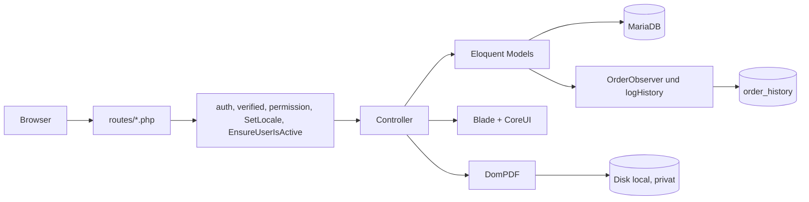

# 01 Architektur

## Technologie-Stack

| Schicht | Technik | Quelle |
|---|---|---|
| Framework | Laravel 12 (installiert: 12.27.0), PHP ^8.2 (lokal 8.4) | `composer.json` |
| Datenbank | MariaDB (`DB_CONNECTION=mariadb`); Tests: SQLite in-memory | `.env.example`, `phpunit.xml` |
| Authentifizierung | Laravel Breeze (nur Login, Passwort-Reset, E-Mail-Verifizierung; keine Registrierung) | `routes/auth.php` |
| Autorisierung | `spatie/laravel-permission` ^6.21 (Rollen und Rechte, Guard `web`) | `config/permission.php` |
| Audit | `spatie/laravel-activitylog` ^4.12 (nur `User` ist geloggt, dazu manuelle Einträge) | `config/activitylog.php` |
| PDF | `barryvdh/laravel-dompdf` ^3.1 (A4, Hochformat, Remote-Zugriff aus) | `config/dompdf.php` |
| Bildverarbeitung | `intervention/image` ^3.11 (nur Avatar in `ProfileController`) | `ProfileController.php` |
| Frontend-Build | Vite 7, `laravel-vite-plugin`, Sass | `vite.config.js`, `package.json` |
| UI | CoreUI 5 (Bootstrap 5), Font Awesome 7 Free, Blade | `resources/scss/app.scss` |
| Frontend-Interaktion | Alpine.js 3 (nur für das Kontaktformular), CoreUI-JavaScript | `resources/js/app.js` |
| Tests | Pest 3 (+ Laravel-Plugin) | `tests/Pest.php` |
| Stil | Laravel Pint (Standardpreset, keine `pint.json`) | `composer.json` |

`barryvdh/laravel-debugbar`, `laravel/sail`, `laravel/pail` sind reine Entwicklungswerkzeuge. Die früher installierten, aber ungenutzten Pakete `spatie/laravel-medialibrary` und `tuytoosh/active` wurden entfernt.

## Verzeichnisstruktur

Organisation nach Fachdomäne (seit Commit `6787310`):

```
app/
  Enums/                    ContactType, OrderStatus
  Http/
    Controllers/
      Admin/                Benutzer, Rollen, Rechte, Aktivitätslog, Arbeitsanweisungen (Verwaltung)
      Auth/                 Breeze-Controller
      Contact/              ContactController
      Order/                Article, Order, OrderPacking, DeliveryNote, OrderAnalytics
      Rental/               Hall, InventoryItem, Rental, Protocol
      DashboardController, ProfileController, LanguageController, WorkInstructionPublicController
    Middleware/             SetLocale, EnsureUserIsActive
    Requests/               Admin/ (PermissionRequest, RoleRequest), Auth/LoginRequest, ProfileUpdateRequest
  Console/Commands/MakeFilesPrivate.php   Befehl files:make-private (Dateien auf die private Disk verschieben)
  Mail/ProtocolFinalizedMail.php
  Models/
    Contact.php, User.php, WorkInstruction.php, WorkInstructionCategory.php
    Order/                  Article, Order, OrderItem, OrderHistory
    Rental/                 Hall, InventoryItem, Rental, Protocol, ProtocolItem, Signature, Photo
  Observers/OrderObserver.php
  Providers/AppServiceProvider.php
  Services/NumberSequence.php   Fortlaufende Nummern ohne Doppelvergabe (Zählertabelle)
  View/Components/          AppLayout, GuestLayout, PublicLayout
bootstrap/app.php           Routing, Middleware-Aliase, Health-Check /up
config/                     Standard plus activitylog, dompdf, permission
database/
  migrations/               35 Dateien (siehe 02-datenmodell.md)
  seeders/                  Rechte und Rollen je Bereich (teilweise veraltet)
lang/{de,en}/               22 Dateien je Sprache, identische Dateiliste
resources/
  views/                    admin, auth, contacts, dashboard, order, rental, public, pdf, emails, layouts, components
  scss/, js/                CoreUI-Einbindung, Vite-Einstieg
routes/                     web, auth, contacts, orders, rental, work_instructions, console
tests/                      nur Breeze-Tests
```

## Request-Ablauf

1. `bootstrap/app.php` registriert `routes/web.php`, die Middleware `SetLocale` und `EnsureUserIsActive` (beide an die Gruppe `web` angehängt) und die Aliase `role`, `permission`, `role_or_permission` (Spatie). `EnsureUserIsActive` meldet einen angemeldeten Benutzer, dessen Konto deaktiviert wurde, beim nächsten Seitenaufruf ab und leitet auf den Login.
2. `routes/web.php` definiert zuerst die öffentlichen Routen (`/language/{locale}`, `/anweisungen/...`). Alle übrigen Fachrouten liegen in der Gruppe `auth` + `verified` und werden über `require` aus `rental.php`, `orders.php`, `contacts.php`, `work_instructions.php` eingebunden. Das Profil liegt in einer eigenen `auth`-Gruppe (ohne `verified`).
3. Der Zugriff wird pro Route mit `permission:<name>` geschützt (nicht per Policy, nicht im Controller). Details in [04-rechte-und-rollen.md](04-rechte-und-rollen.md).
4. `AppServiceProvider::boot()` setzt `Gate::before`: Wer die Rolle `super-admin` hat, besteht jede Prüfung. Zusätzlich wird `OrderObserver` an `Order` gehängt.
5. Controller validieren überwiegend inline mit `$request->validate()`, rufen Eloquent direkt auf und geben Blade-Views oder Redirects mit Flash-Meldung zurück. Es gibt keine Service- oder Repository-Schicht; Fachlogik liegt zum Teil im Model (`Order`, `OrderItem`) und zum Teil im Controller (`ProtocolController`, `RentalController`).



## Konfiguration und Besonderheiten

- Zeitzone ist `Europe/Berlin` (`config/app.php`, überschreibbar über `APP_TIMEZONE`, früherer Befund M8). Nummernkreise, Tagesgrenzen (Dashboard "heute", Auswertungen) und alle neu geschriebenen Zeitstempel (`created_at`, `delivered_at`, ...) richten sich nach deutscher Zeit; der Jahreswechsel der Nummernkreise erfolgt um Mitternacht deutscher Zeit. Laravel speichert Zeitstempel ohne Umrechnung in der Anwendungszeitzone. Datensätze, die vor der Umstellung entstanden sind, wurden in UTC geschrieben und zeigen weiterhin dieselbe Uhrzeit wie zuvor (1 bis 2 Stunden vor der deutschen Ortszeit); sie wurden nicht umgerechnet. Vom Benutzer eingegebene Zeiten (`rentals.start`, `rentals.end`) und Datumsfelder (`delivery_date`) sind Ortszeit und von der Umstellung nicht betroffen.
- Sprachen: `de` (Standard) und `en` (Fallback), erlaubt laut `config('app.available_locales')`. Die Wahl liegt in der Session (`LanguageController`, Route `language.switch`); `SetLocale` setzt sie je Request.
- Primärschlüssel: überall UUID (außer `users`), erzeugt mit Laravels `HasUuids` (einheitlich in allen Models; der frühere eigene Trait `HasUuid` der Vermietung wurde entfernt). `HasUuids` erzeugt in Laravel 12 zeitlich sortierbare UUIDs (Version 7); ältere Datensätze der Vermietung behalten ihre zufälligen UUIDs, beides passt in `char(36)`.
- Konfiguration über `.env` (nicht versioniert, siehe `.gitignore`). Vorlage: `.env.example`. Produktionsvorgaben in der Vorlage: `APP_ENV=production`, `SESSION_DRIVER=database`, `QUEUE_CONNECTION=database`, `CACHE_STORE=database`, `LOG_STACK=single,slack`.
- Das Aktivitätslog speichert laut Konfiguration 365 Tage. Der Scheduler führt täglich `activitylog:clean` aus (`routes/console.php`, früherer Befund M10); dafür muss auf dem Server der Cronjob `* * * * * php artisan schedule:run` laufen (siehe [06-entwicklung-und-betrieb.md](06-entwicklung-und-betrieb.md)). Die Tabelle `order_history` wird nicht bereinigt.

## Dateispeicher

Dateien mit Personenbezug (Lieferscheine, Protokolle, Unterschriften, Fotos) liegen auf der privaten Disk `local` (`storage/app/private`) und sind nicht über `/storage` erreichbar. Sie werden ausschließlich über Routen mit Anmeldung und Berechtigung ausgeliefert. Nur Inhalte, die in der Oberfläche direkt per URL eingebunden werden (Avatare), liegen auf der Disk `public` (`storage/app/public`, URL `/storage`):

| Disk | Pfad | Inhalt | Erzeugt in | Auslieferung |
|---|---|---|---|---|
| `local` (privat) | `delivery-notes/delivery-note-{order_number}.pdf` | Lieferschein | `Order::generateDeliveryNote()` | `delivery-notes.download`/`print`, Recht `orders.print` |
| `local` (privat) | `protocols/{protocol_id}/final.pdf` | Finales Protokoll | `ProtocolController::sign()` | `protocol.pdf`, Recht `protocols.pdf`; Mailanhang |
| `local` (privat) | `protocols/{protocol_id}/sign-{uuid}.png` | Unterschriften | `ProtocolController::sign()` | nur eingebettet im Protokoll-PDF |
| `local` (privat) | `protocols/{protocol_id}/photos/...` | Protokollfotos | `ProtocolController::saveForm()` | nur eingebettet im Protokoll-PDF |
| `local` (privat) | `work-instructions/{category_id}/{uuid}.pdf` | Arbeitsanweisungen | `Admin\WorkInstructionController` | Route `/anweisungen/{slug}/{id}` ohne Login, aber nur für aktive Kategorie und aktive Anweisung |
| `public` | `avatars/{user_id}/avatar-{uuid}.webp` | Benutzerbilder | `ProfileController` | direkte URL, wird in der Oberfläche angezeigt |

Die Pfade in der Datenbank sind relativ und gelten unabhängig von der Disk. Bestehende Dateien werden mit `php artisan files:make-private` von `public` nach `local` verschoben (siehe [06-entwicklung-und-betrieb.md](06-entwicklung-und-betrieb.md)). Befund S1 in [08-bekannte-probleme.md](08-bekannte-probleme.md) ist damit behoben. Die Arbeitsanweisungen sind inhaltlich öffentlich, liegen aber ebenfalls auf der privaten Disk. Sie sind nur über die Route `/anweisungen/...` erreichbar, die Aktiv-Flags von Kategorie und Anweisung prüft; eine direkte `/storage`-URL gibt es nicht.

## PDF-Erzeugung

| Dokument | Template | Auslöser |
|---|---|---|
| Lieferschein | `order/delivery-notes/template.blade.php` | `Order::generateDeliveryNote()`; Sprache wird für die Erzeugung auf `de` gesetzt |
| Analyse-Report | `order/analytics/report-pdf.blade.php` | `OrderAnalyticsController::exportReport()` (Download, nicht gespeichert) |
| Protokoll | `pdf/protocol.blade.php` | `ProtocolController::sign()`, sobald Mieter und Vermieter unterschrieben haben; Unterschriften und Fotos werden als Data-URI eingebettet, ein SHA-256 des PDFs wird gespeichert |

## Mehrsprachigkeit

- Sprachdateien liegen je Bereich in `lang/{de,en}/*.php` mit identischer Dateiliste.
- Views nutzen überwiegend `__('datei.schluessel')`; in einzelnen Views der Vermietung (Hallen, Inventar, Protokolle, Vermietungen) stehen noch feste deutsche Texte. Alle Meldungen der Controller (Erfolg, Fehler, `abort`) laufen über `__()` und liegen in `lang/de` und `lang/en` unter `<bereich>.messages.*`; `tests/Feature/Quality/CodeConventionsTest.php` schlägt bei neuen festen Texten in Controllern fehl. Interne Ausnahmetexte (Logs, Modelle) sind englisch und nicht für Benutzer bestimmt.
- Der `OrderObserver` und `Order::logHistory()` schreiben englische Beschreibungstexte in `order_history`.

## Frontend

- Einstieg: `resources/js/app.js` importiert `bootstrap.js`, das CoreUI komplett lädt und als `window.coreui` bereitstellt. Styles: `resources/scss/app.scss` (CoreUI, Font Awesome, `_theme.scss`).
- Layouts als Blade-Komponenten: `<x-app-layout>` (Sidebar-Navigation mit Rechteprüfung über `@can`), `<x-guest-layout>` (Login), `<x-public-layout>` (Arbeitsanweisungen ohne Login).
- Navigation: `resources/views/layouts/navigation.blade.php`. Der Menüpunkt "Berechtigungen" ist auskommentiert; die Route bleibt erreichbar.
- Inline-Skripte gibt es in vier Views (`admin/activity-log/index`, `order/orders/_form`, `rental/halls/_form`, `rental/protocol/form`). Die Unterschrift lädt `signature_pad@4.1.7` per CDN. Die Auswertungsseite rendert serverseitig; die JSON-Endpunkte `/analytics/api/*` werden von keiner View aufgerufen.
- Alpine.js ist über npm (`alpinejs`) und Vite eingebunden: `resources/js/app.js` importiert es und ruft `Alpine.start()` auf (früherer Befund M3). Tatsächlich genutzt wird es nur in `contacts/_form.blade.php` (Ein- und Ausblenden von Ansprechpartner und Adresse je nach Kontakttyp). Ausgeblendete Elemente tragen `x-cloak`, die Regel `[x-cloak]` steht in `resources/scss/app.scss`, damit sie vor dem Start von Alpine nicht aufblitzen. `components/dropdown.blade.php` und `components/modal.blade.php` (Breeze-Reste mit Tailwind-Klassen) enthalten ebenfalls Alpine-Direktiven, werden aber nirgends verwendet.
- Flash-Meldungen verwenden drei verschiedene Schlüssel: `ok`, `status`, `error`.
