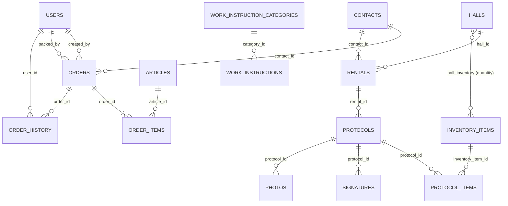
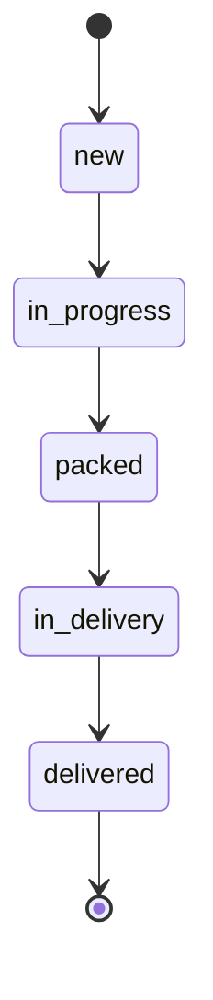

# 02 Datenmodell

Alle Fachtabellen verwenden UUIDs (`char(36)` in MariaDB) als Primärschlüssel. `users.id` ist ein `bigint`, daher sind Fremdschlüssel auf Benutzer (`created_by`, `packed_by`, `user_id`) `bigint`.

## ER-Diagramm

## Tabellen

### Kontakte

**`contacts`** (Model `App\Models\Contact`, Trait `HasUuids`)

| Spalte | Typ | Hinweis |
|---|---|---|
| `id` | uuid PK | |
| `type` | string, Default `customer` | Cast auf Enum `ContactType`: `tenant`, `customer`, `both` |
| `name` | string | Pflicht |
| `contact_person_name` | string, null | |
| `email`, `phone` | string, null | |
| `street`, `zip_code`, `city`, `address_notes` | null | Adresse; für Lieferaufträge erforderlich |
| `notes` | text, null | |
| `customer_number` | string(20), unique, null | Format `CUS-JJJJ-NNNN`; wird beim Anlegen vergeben, außer bei reinen Mietern |
| `is_active` | bool, Default true | |
| Indizes | `type`, `name`, `is_active` | |

Scopes: `active()`, `tenants()` (tenant, both), `customers()` (customer, both). Accessor `formatted_address`.

### Auftragsverwaltung

**`articles`** (`Order\Article`, `HasUuids`, `SoftDeletes`): `name`, `sku` (unique, null), `description`, `price` decimal(10,2) null, `is_active`. Soft Delete seit Migration `2026_04_11_000002`.

**`orders`** (`Order\Order`, `HasUuids`)

| Spalte | Hinweis |
|---|---|
| `order_number` | unique, Format `ORD-JJJJ-NNNN`, vergeben in `Order::boot()` |
| `contact_id` | FK auf `contacts`, `nullOnDelete`, indiziert |
| `delivery_date` | date |
| `delivery_type` | DB-Enum `delivery`, `pickup` (kein PHP-Enum) |
| `status` | DB-Enum, Cast auf `OrderStatus` |
| `notes` | text |
| `delivery_note_path`, `delivery_note_printed_at` | Lieferschein |
| `created_by` | FK `users`, nullable, `nullOnDelete` (seit Migration `2026_10_23_000003`; früher `cascade`); bleibt leer, wenn der Ersteller gelöscht wurde |
| `packed_by` | FK `users`, `set null` |
| `delivered_at` | timestamp |
| `deleted_at` | Soft Delete (seit Migration `2026_10_23_000001`); gelöschte Aufträge bleiben samt Positionen und Historie erhalten und sind in Listen, Detailseiten und Auswertungen nicht mehr sichtbar |
| Indizes | `status`, `order_number`, `created_at` |

**`order_items`** (`Order\OrderItem`): `order_id` (cascade), `article_id` (null, `set null`), Schnappschuss-Felder `article_name`, `article_sku`, `article_price`, Mengen `quantity_ordered`, `quantity_packed`, Flag `is_packed`, `packed_at`, `packed_by`, `notes`. Indizes auf `order_id`, `is_packed`, `article_id`.

**`order_history`** (`Order\OrderHistory`, Tabellenname explizit gesetzt; bleibt auch nach dem Löschen eines Auftrags erhalten): Audit je Auftrag mit `event_type`, `description`, `metadata` (JSON), `ip_address`, `user_agent`, `user_id` (`set null`). Index `(order_id, created_at)`, `event_type`, `(order_id, event_type)`.

Die frühere Kundendaten-Duplizierung in `orders` (`customer_name`, `customer_email`, `customer_phone`, `customer_address`) wurde in Migration `2025_11_23_084825` entfernt; Kundendaten kommen jetzt ausschließlich über `contact_id`.

### Vermietung

| Tabelle | Model | Wesentliche Spalten und Regeln |
|---|---|---|
| `halls` | `Rental\Hall` | `name`, `address`, `notes` |
| `inventory_items` | `Rental\InventoryItem` | `name`, `sku`, `description` |
| `hall_inventory` | Pivot (ohne Model) | `hall_id`, `inventory_item_id`, `quantity` (Default 1), unique `(hall_id, inventory_item_id)`, beidseitig `cascade` |
| `rentals` | `Rental\Rental` | `contact_id` (FK `contacts`, `nullOnDelete`), `hall_id` (cascade), `start`, `end` (datetime), `price`, `deposit`, `status` (String: `scheduled`, `active`, `closed`, `cancelled`), Indizes `status`, `(start,end)`, `(hall_id,status)`, `contact_id` |
| `protocols` | `Rental\Protocol` | `rental_id` (cascade), `type` (Enum `handover`, `return`), `checklist` (JSON, Zählerstände), `notes`, `meta` (JSON: IP, User-Agent), `pdf_path`, `pdf_sha256`; unique `(rental_id, type)` |
| `protocol_items` | `Rental\ProtocolItem` | `protocol_id`, `inventory_item_id` (`set null`), `label`, `state` (Enum `ok`, `missing`, `damaged`), `comment`, `charge` |
| `signatures` | `Rental\Signature` | `protocol_id`, `role` (Enum `tenant`, `landlord`), `signer_name`, `png_path`, `signed_at` |
| `photos` | `Rental\Photo` | `protocol_id`, `path`, `caption` |

Ein Protokoll gilt als finalisiert, sobald `pdf_path` gesetzt ist. Danach sind Speichern und Unterschreiben gesperrt.

### Arbeitsanweisungen

**`work_instruction_categories`**: `name`, `slug` (unique, beim Anlegen aus dem Namen erzeugt, bei Kollision mit Suffix `-2`, `-3`, ...), `sort_order` (smallint), `is_active`. Der Slug wird beim Umbenennen nicht angepasst.

**`work_instructions`**: `category_id` (cascade), `title`, `pdf_path`, `sort_order`, `is_active`.

### Benutzer, Rechte, Technik

| Tabelle | Herkunft |
|---|---|
| `users` | Laravel plus `avatar_path`; Primärschlüssel `bigint` |
| `roles`, `permissions`, `model_has_roles`, `model_has_permissions`, `role_has_permissions` | Spatie Permission |
| `activity_log` | Spatie Activitylog (inkl. `event`, `batch_uuid`) |
| `number_sequences` | Zähler für Nummernkreise: `name` (PK, z. B. `order-2026`, `customer-2026`), `last_value`, Zeitstempel (siehe Abschnitt Nummernkreise) |
| `cache`, `cache_locks`, `jobs`, `job_batches`, `failed_jobs`, `sessions`, `password_reset_tokens` | Laravel-Standard (Treiber `database`) |

## Enums

**`OrderStatus`** (`app/Enums/OrderStatus.php`) mit `label()` (Übersetzung), `color()` (Bootstrap-Klassen) und `canTransitionTo()`:

Es gibt keine Rücksprünge und kein Storno. Bearbeitbar (Auftrag und Positionen) ist ein Auftrag nur in `new` und `in_progress`.

**`ContactType`** (`app/Enums/ContactType.php`): `tenant`, `customer`, `both`.

## Nummernkreise

| Nummer | Format | Erzeugung | Schwäche |
|---|---|---|---|
| Auftrag | `ORD-JJJJ-NNNN` | `Order::generateOrderNumber` über `NumberSequence::next("order-JJJJ")` | Atomar (siehe unten). Die Nummer bleibt auch nach dem Löschen (Soft Delete) des Auftrags belegt. |
| Kunde | `CUS-JJJJ-NNNN` | `Contact::generateCustomerNumber` über `NumberSequence::next("customer-JJJJ")` | Atomar (siehe unten). Reine Mieter erhalten keine Kundennummer. |

Vergabe: `App\Services\NumberSequence::next()` zählt den Eintrag in `number_sequences` innerhalb einer Transaktion mit Zeilensperre (`lockForUpdate`) hoch. Gleichzeitige Anfragen erhalten dadurch verschiedene Nummern. Beim ersten Zugriff auf einen Zähler (neues Jahr oder erste Nutzung nach der Migration) wird er aus der höchsten vorhandenen Nummer abgeleitet (`highestSuffix`, einschließlich gelöschter Aufträge, auch über 9999 hinaus), sodass bestehende Daten weitergezählt werden. Der Jahreswechsel richtet sich nach der Anwendungszeitzone (UTC, siehe M8). Lücken sind möglich, wenn ein Anlegevorgang nach der Nummernvergabe scheitert; eine Doppelvergabe ist ausgeschlossen. Ein Zähler lässt sich über `number_sequences.last_value` zurücksetzen oder setzen.

## Migrationshistorie

| Zeitraum | Inhalt |
|---|---|
| 2025-08/09 | Laravel-Basis, Spatie-Permission, Kerntabellen der Vermietung (`2025_09_01_000000_create_core_tables`), Avatar |
| 2025-11-18/19 | Auftragsverwaltung: `articles`, `orders`, `order_items`, `order_history`, Kundentabelle (später entfernt) |
| 2025-11-23 | Adressstruktur, Lieferart und Lieferdatum; Standard-Lieferdatum für Altaufträge |
| 2026-03-11 | Zusätzliche Indizes |
| 2026-04-11 | Soft Deletes für Artikel, Activity-Log-Tabellen |
| 2026-04-12 `000001`-`000007` | Zusammenführung zu `contacts`: Tabelle anlegen, Mieter und Kunden kopieren (gleiche UUIDs), `contact_id` ergänzen, befüllen und FKs setzen, Altspalten und Alttabellen löschen (nicht umkehrbar), Rechte `tenants.*`/`customers.*` auf `contacts.*` abbilden |
| 2026-04-12 `200001`-`200003` | Arbeitsanweisungen, Recht `work-instructions.manage` |
| 2026-10-23 `000001`-`000003` | Soft Delete für Aufträge, Tabelle `number_sequences`, `orders.created_by` auf `nullOnDelete` |

Hinweise zur Kontakt-Migration: Die Kopie der Kunden setzt voraus, dass keine UUID zwischen `tenants` und `customers` kollidiert (im Code nur als Kommentar vermerkt, nicht geprüft). Migration `000006` ist mit einer Exception als irreversibel markiert; vor dem Einspielen in Produktion ist ein Backup zwingend.
